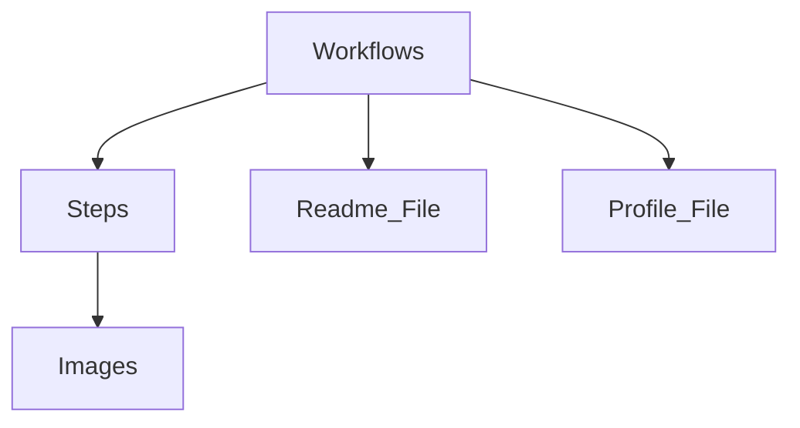

## 1. Stack
- No application code, no manifest found (no package.json/go.mod/pyproject.toml/Cargo.toml at REPO_ROOT).
- Content types present: Markdown (README.md, PROFILE.md, .github/steps/*.md) and YAML (.github/workflows/*.yml).
- This is a GitHub Skills exercise template ("Introduction to GitHub"), not a runnable software project — confirmed by README.md content (exercise completion page, links to `learn.github.com/skills`).
- Automation framework: GitHub Actions (inferred from `.github/workflows/*.yml` file paths only; contents not read per task scope).

## 2. Directory map
| path | what lives there |
|---|---|
| `.github/workflows/` | GitHub Actions YAML files, numbered `0-start-exercise.yml` … `4-merge-your-pull-request.yml` |
| `.github/steps/` | Markdown lesson content, numbered `1-create-a-branch.md` … `4-merge-your-pull-request.md`, plus `x-review.md` |
| `.github/images/` | 9 PNG screenshots referenced by step docs |
| `PROFILE.md` | One-line file; the hands-on artifact students edit during the exercise |
| `README.md` | Exercise status/progress page (current content is the completion page) |
| `LICENSE` | MIT license |
| `.gitignore` | Git ignore rules |

## 3. Diagram

Note: nodes named `Readme_File`/`Profile_File` (not `Readme`/`Profile`) to avoid
case-insensitive filename collision with the repo's own `README.md`/`PROFILE.md`.

## 4. Component index
- [[Workflows]]
- [[Steps]]
- [[Images]]
- [[Profile_File]]
- [[Readme_File]]

## 5. Entry points
- No dev/prod application entry point exists — no manifest, no `main.*`/`index.*`/`app.*` found at REPO_ROOT, `src/`, or `app/` (neither `src/` nor `app/` exist).
- The only "runtime" is GitHub Actions triggered by repo events (push, branch creation, PR, merge) via `.github/workflows/*.yml` — TODO: verify exact triggers (workflow file contents were not read; out of task scope).

## 6. Conventions
- Workflow files and step files share a numeric prefix scheme observed directly in the file listing: `0-start-exercise.yml` has no step counterpart; `1-create-a-branch.yml` ↔ `1-create-a-branch.md`; `2-commit-a-file.yml` ↔ `2-commit-a-file.md`; `3-open-a-pull-request.yml` ↔ `3-open-a-pull-request.md`; `4-merge-your-pull-request.yml` ↔ `4-merge-your-pull-request.md`; `x-review.md` has no numbered workflow counterpart.
- README.md is written in the completed/answer state at time of reading (not a static hand-authored doc) — TODO: verify whether workflows overwrite it (not confirmed by file contents read).

## 7. Where things go
- To add a new exercise step: add `.github/steps/N-name.md` and a matching `.github/workflows/N-name.yml` (TODO: verify workflow internals before authoring).
- To add a new screenshot: place PNG in `.github/images/` and reference it from the relevant `.github/steps/*.md` file.
- To change the hands-on task file: edit `PROFILE.md` (this is the file the exercise instructs the student to modify).
- To change licensing terms: edit `LICENSE` only.
